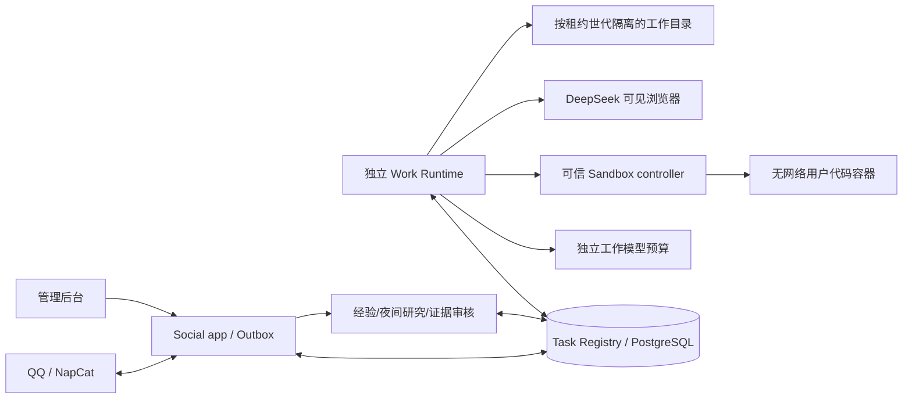

# 0.3 双运行时增量

领域协议在 domain/work.py；Social facade/WorkAgent 在 application/v2；数据库和模型/研究进程组合在 infrastructure/v2；管理接口在 interfaces/v2.py。Work不持有 NapCat Token，不挂载 Social 的原始消息/附件卷，用户代码也不获得 Work 模型密钥或 Docker Socket。SQL事务不跨模型或工具等待持有。

新服务器建议与实际边界见 [部署指南](server-4c8g.md)、[V2 对照](v2-implementation.md)。下面保留既有功能模块架构：

# 0.2 架构

单进程模块化单体 + 按风险隔离的 Worker。`main.py` 只组装实例；domain 定义实体/权限/Port；application 调度工作流；infrastructure 实现 SQL、网络和供应商适配；interfaces 处理 HTTP、WebSocket 和 WebUI。内层禁止依赖 FastAPI、SQLAlchemy、OneBot 或模型 SDK，架构测试会检查。

```mermaid
flowchart TB
  QQ[NapCat] --> WS[鉴权与事件归一化]
  WS --> Inbox[Inbox / 去重]
  Inbox --> Agent[AgentRuntime / 社交决策]
  Agent --> Memory[访问与披露权限 / 记忆]
  Agent --> Knowledge[群作用域知识 / 混合检索]
  Agent --> Jobs[持久化任务与审批]
  Jobs --> Browser[可见DeepSeek浏览器 / 人工登录]
  Jobs --> Parser[独立文档与视频解析]
  Jobs --> Sandbox[Docker控制器 / 无网络执行容器]
  Jobs --> Screenshot[无账号截图浏览器]
  Agent --> Outbox[Outbox / 发送前复核]
  Jobs --> Outbox
  Outbox --> QQ
  UI[WebUI] --> API[管理与群域RBAC]
  API --> Jobs
  API --> Live[HttpOnly会话 / noVNC代理]
  Live --> Browser
  Memory --> DB[(PostgreSQL / SQLite)]
  Knowledge --> DB
  Jobs --> DB
```

## 模块

- `domain/entities.py`、`ports.py`、`features.py`：稳定类型、协议与权限数据。
- `application/runtime.py`：社交/模型/证据编排、回放和 Outbox 调度。
- `application/features/hub.py`：命令路由、任务 Handler 组装、发送依赖检查和周期调度；算法分别在知识、研究、记忆、媒体、插件服务。
- `application/features/tasks.py`：排队、一次性审批、取消、有限重试、重启恢复。
- `knowledge.py`：页码切片、Embedding、许可和 scope、RRF 排序。
- `consolidation.py`：按日期整理、来源与主体校验、情景与事实去重。
- `research.py`：搜索证据和必经 DeepSeek 网页、人工等待、预算和历史。
- `infrastructure/features/wiring.py`：完整功能的依赖组装。
- `interfaces/browser.py`：owner 的登录桌面接口、静态和 WebSocket 映射。
- `workers/`：浏览器、解析、截图、执行器；不 import 服务器运行时。

## 数据

核心消息仍在 events，机器人回复和确认在 outbox_messages，决策/回放在 decision_logs，事实在 memories。完整能力使用有索引的 feature_records：kind、owner_id、group_id、status、dedupe_key、payload、时间。Record 的权限域是独立列，不能靠 payload 中的文字自称授权。

Feature kinds 包括 job.*、approval、document、chunk/public_chunk、episode、memory_evidence、memory_index、research、media、media_analysis、sticker、plugin、model_usage、model_route、thread、maintenance 等。统一存储适合首个完整版本；后续可按模块拆分专表，不改变 Port。

SQLite 向量在 feature_vectors；PostgreSQL 迁移额外创建 feature_vectors_pg，使用 pgvector 的真实 vector 列。按模型和维度区分，检索先取得授权候选，再在对应 ID 集合内计算距离。

## 一致性与边界

Inbox 至少一次交付，唯一键去重。决策与 Outbox 同事务；Outbox 请求发出后失去确认会记录 unknown，不无条件重发。重启处理中的代码/社交写不会盲目重复。远程任务通过稳定请求 ID 恢复。

发出前再次检查：源/上下文消息未撤回、记忆当前可披露、知识文档版本未删除、群/工具权限仍存在、任务未取消、TTL 和暂停开关。跨群个人事实和知识依赖的旧回复不会直接重新混入聊天历史。外部调用已经发出后，后来的撤销无法追回请求。

本版单应用副本，群内 asyncio 锁、有限并发、持久化队列。还没有分布式连接路由、跨实例群租约或账单级费用结算，不应直接运行多副本共享 QQ 连接。接口允许未来替换队列、数据库与 Provider。

## V3 核心运行时

Decision → Thinking → Reply；硬规则在模型前检查，Outbox 在发送前再核对。Thinking 的封闭工具目录只接受网关注入身份；异步 Coding/Research 返回持久化 ID，完成事件唤醒父会话。不同群只占用自己的短会话，消息调度不会把空闲并发槽一直等在慢群的锁上。

V2 任务事务同时写 V3 投影、领域事件和唤醒；外部写操作使用未知状态标记和读取调和。Observer 只拿一致快照，不读写活跃目录。可选 OpenCode 网关为每个工作区创建独立容器和两份卷，专业代理不进入 Social 进程。详细边界见 v3-implementation.md、protocols/agents-v1.md 和 adr/003-v3-agent-runtime.md。
